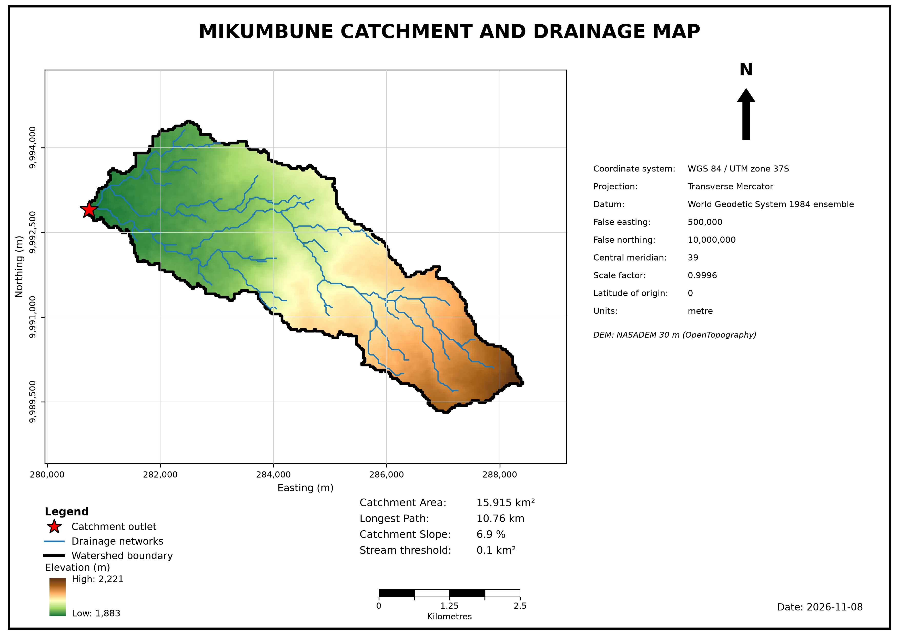
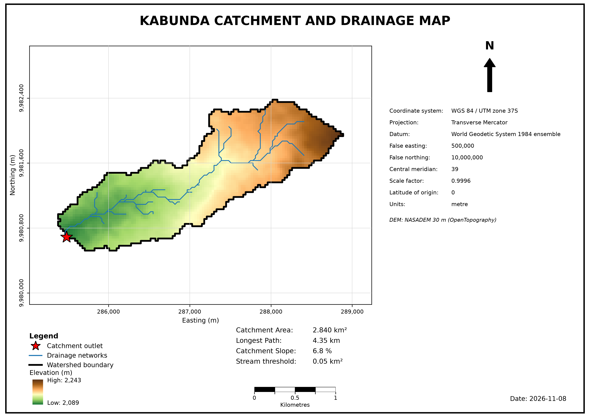
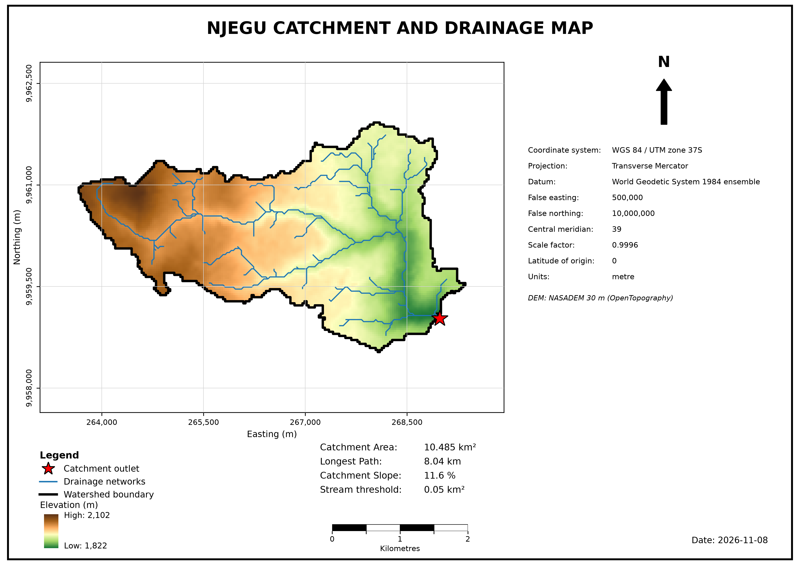
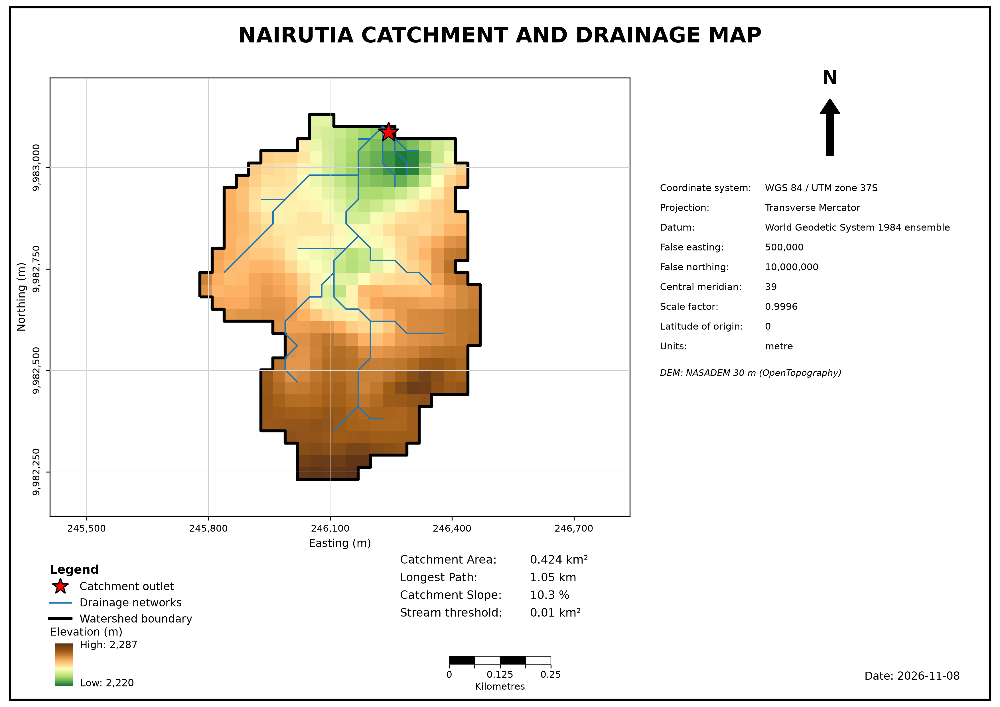

# dam_drainage_mapping

## Overview

Catchments and stream networks were delineated for 4 dams in Nyeri County, Kenya, from a 30 m digital elevation model (DEM) using pysheds. The result is one drainage map per dam.

## Study area

Dam outlet coordinates, in WGS 84 / UTM zone 37S (EPSG:32737), as set in `config/dams.yaml`:

| Dam | Easting (m) | Northing (m) |
|---|---|---|
| Mikumbune | 280731.943 | 9992881.7855 |
| Kabunda | 285571.005 | 9980597.840 |
| Njegu | 269023.697 | 9959111.626 |
| Nairutia | 246212.093 | 9983114.053 |

## Data

- DEM: NASADEM 30 m, void-filled.
- Downloaded from OpenTopography by `scripts/get_dem.py`.
- Reprojected to WGS 84 / UTM zone 37S (EPSG:32737) with bilinear resampling.

## Method

1. **DEM conditioning:** fill pits, fill depressions, resolve flats.
2. **Flow routing:** D8 flow direction and flow accumulation.
3. **Outlet snapping:** each dam point snaps to the nearest cell draining at least 0.1 km² (`snap_threshold_km2`). Snaps over 100 m are flagged.
4. **Outlet check:** for Kabunda and Nairutia, the highest-accumulation cell within 50–300 m of the dam point was examined to confirm the snapped outlet is on the dam's channel.
5. **Catchment delineation:** one catchment per outlet, with its area, a check for touching the DEM edge or nodata cells, and a check for other dams' outlets inside it (nested catchments).
6. **Stream extraction:** cells above a contributing-area threshold, clipped to each catchment. The default threshold is 0.1 km². It was lowered for some dams to show tributaries in the smaller catchments.

| Dam | Stream threshold (km²) |
|---|---|
| Mikumbune | 0.10 |
| Kabunda | 0.05 |
| Njegu | 0.05 |
| Nairutia | 0.01 |

All parameters are set in `config/dams.yaml`.

## Results

| Dam | Snap distance (m) | Catchment area (km²) | Stream threshold (km²) | Stream segments |
|---|---|---|---|---|
| Mikumbune | 19.0 | 15.91 | 0.10 | 73 |
| Kabunda | 124.1 | 2.84 | 0.05 | 33 |
| Njegu | 94.0 | 10.49 | 0.05 | 93 |
| Nairutia | 42.2 | 0.42 | 0.01 | 22 |

No catchment touches the DEM edge, and none is nested inside another.



*Mikumbune Dam: 15.91 km² catchment, streams at 0.10 km² threshold.*



*Kabunda Dam: 2.84 km² catchment, streams at 0.05 km² threshold.*



*Njegu Dam: 10.49 km² catchment, streams at 0.05 km² threshold.*



*Nairutia Dam: 0.42 km² catchment, streams at 0.01 km² threshold.*

## Limitations

- Stream thresholds differ between dams, so stream density is not comparable across the maps. Each map states its threshold.
- At low thresholds, and on flat ground such as around Nairutia, the lines are DEM-derived flow paths and may not all be channels on the ground.
- Kabunda's snap (124.1 m) exceeds the 100 m check because the given point lies on the hillslope beside its tributary. The outlet check confirmed the snapped outlet is on the tributary the dam sits on.
- The 30 m DEM resolution and its vertical error limit accuracy for small catchments.

## Reproducing

1. Create and activate the conda environment:

   ```
   conda env create -f environment.yml
   conda activate dam-drainage
   ```

   numpy is pinned below 2.4 because pysheds 0.5 uses a function that was removed in numpy 2.4.

2. Get a free API key from [OpenTopography](https://opentopography.org/) and set it as the `OPENTOPO_API_KEY` environment variable.

3. Download and reproject the DEM:

   ```
   python scripts/get_dem.py
   ```

4. Run `notebooks/01_delineation.ipynb`, then `notebooks/02_make_maps.ipynb`.

`data/` and `outputs/` are not tracked by git. The script and notebooks create them. The maps are saved to `figures/`.

## Licence

Apache 2.0. See [LICENSE](LICENSE).
